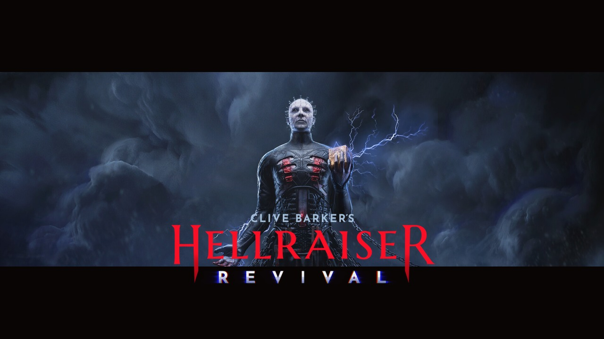

  

<h1 align="center">Clive Barker's Hellraiser: Revival — Indonesian Localization</h1>

  <b>Mod Lokalisasi & Terjemahan Bahasa Indonesia untuk Game Clive Barker's Hellraiser: Revival (PC Steam / Steam Deck)</b> 
  <i>Diterjemahkan & Dikembangkan oleh Divisi Game Modding & Lokalisasi Milky Brain</i>

  
  
  
  

---

Mod lokalisasi Bahasa Indonesia untuk game **Clive Barker's Hellraiser: Revival** (Saber Interactive) buatan **Milky Brain**.

Dibuat khusus bagi gamer Indonesia yang ingin merasakan kengerian horor psikologis, misteri *Genesis Configuration*, filosofi transendental para Cenobite, dan teror sadomasokistik kultus *Scarlet Church* dalam Bahasa Indonesia yang **alami, berkarakter, peka konteks adegan (*context-aware*)**, dan bebas dari terjemahan mesin kaku (anti-Google Translate).

---

## 🌟 Fitur Utama & Standar Kualitas

### 1. Terjemahan Kontekstual & Persona Karakter (Context-Aware)
Seluruh naskah dialog cerita (Prologue hingga Epilogue) diterjemahkan dengan menghidupkan dinamika psikologis dan emosi setiap tokoh:
* **Aidan Lynch (Protagonis)**: Putus asa mencari Sunny, tegang, sinis di bawah tekanan konstan, protektif, dan manusiawi (`aku - kau`).
* **Hell Priest (Pinhead)**: Dingin, berwibawa agung, filosofis mengerikan, memandang penderitaan daging sebagai seni transenden tanpa emosi manusiawi.
  > *"Nyawa, sekali direnggut, tak akan dikembalikan cuma-cuma. Terima kesepakatan ini, atau tunduklah."*
* **Marlowe**: Pemimpin kultus *Scarlet Church*. Fanatik teatrikal dengan tutur kata sopan manipulatif yang menyamarkan kegilaan sadomasokistiknya.
* **Sunny**: Tersiksa, menghantui penglihatan batin Aidan, emosional dan penuh kepedihan.
* **Bruno Keller**: Algojo Marlowe yang kasar, congkak, dan gemar mengejek mangsa.
* **Sean (Gravekeeper)**: Penjaga makam sinis, letih, dan menyimpan rahasia kelam.
* **Zora (The Eremite)**: Entitas separuh Cenobite (*half-o-bite*) misterius yang berbicara dalam teka-teki pengamat netral.
* **Sister of Mercy (Som)**: Provokatif, sadis, dan terobsesi dengan batasan rasa sakit.
* **Kultis Scarlet Church**: Fanatik histeris yang memuja daging dan jeratan rantai neraka.

### 2. Sinkronisasi Fonetik Kata Terbata-bata (Stuttering Synchronization)
Huruf dan suku kata gagap diselaraskan secara fonetik dengan kata hasil terjemahan Bahasa Indonesia:
* *"W-wait! I'll do whatever you want..."* ➔ *"T-tunggu! Aku bakal lakuin apa pun kemauan kalian..."* (Konsonan `T`, bukan `W-tunggu`).
* *"W-we're ready!"* ➔ *"K-kami siap!"* (Konsonan `K`, bukan `W-kami`).
* *"N-no, don't stop!"* ➔ *"J-jangan, jangan berhenti!"* (Konsonan `J`, bukan `N-jangan`).

### 3. Kebijakan Bahasa Standar (English UI / Indonesian Dialogue)
* **Menu, HUD, & Pengaturan**: Menu utama, opsi grafis/audio, tombol kontrol, dan teks sistem tetap dalam **Bahasa Inggris original** guna menjaga familiaritas dan navigasi build internasional.
* **Nama Senjata & Kunci Item**: Nama item penting (`Colt`, `AK-47`, `.357 cartridge`, `Shotgun Shells`) tetap English original.
* **Deskripsi & Tutorial**: Deskripsi senjata/item dan penjelasan mekanik tutorial diterjemahkan ke Bahasa Indonesia natural tanpa merusak tombol aksi kontrol (`<KeyInfo Input="Input.Interact"/>`).

### 4. Dokumen Lore, Kaset Rekaman & Death Hints 100% Selesai
* **153 Dokumen Lore**: Seluruh Bab 1 s/d 6 mengenai asal-usul Cenobite Orno, metamorfosis Marlowe, misteri *Sister of Mercy*, dan keturunan *Eremite*.
* **22 Audio Tapes**: Kaset rekaman para pengikut kultus di berbagai lokasi.
* **169 Death Hint Texts**: Tips bertahan hidup di layar *Game Over*.
* **108 Environmental Subtitles (`ST_UI_ArtLoc`)**: Inskripsi dinding, coretan grafiti, dan petunjuk teka-teki ruangan.

### 5. Arsitektur Direct Base Container Injection (Zero Crash & 100% Terbaca)
* Game ini menggunakan Unreal Engine IoStore V11 yang mengunci pemuatan aset pada kontainer resmi.
* Mod diinjeksikan langsung ke dalam kontainer dasar `pakchunk0-Windows.pak` (89 MB) dengan preservasi *PathHashSeed* `0x0BF2F7AD` dan kompresi *Oodle*.
* 100% bebas dari file konfigurasi `.ini` liar (mencegah *black screen* / crash shader).
* Aman dimainkan di PC Windows maupun Steam Deck (Proton).

---

## 📥 Cara Pemasangan (Sangat Mudah - Drop-In)

1. Unduh paket rilis **`Hellraiser_Revival_Indonesian_Translation_v1.0.zip`** dari tab **[Releases](../../releases)**.
2. Buka folder instalasi game **Clive Barker's Hellraiser: Revival** di Steam:
   * Klik kanan game di Steam Library ➔ **Kelola (Manage)** ➔ **Telusuri File Lokal (Browse local files)**.
   * Path default Windows:  
     `C:\Program Files (x86)\Steam\steamapps\common\Clive Barker's Hellraiser - Revival\`
   * Path default Linux / Steam Deck:  
     `~/.steam/steam/steamapps/common/Clive Barker's Hellraiser - Revival/`
3. *(Sangat Disarankan)* Masuk ke folder `Hellraiser/Content/Paks/` dan buat salinan cadangan file `pakchunk0-Windows.pak` menjadi `pakchunk0-Windows.pak.orig.bak`.
4. Ekstrak folder **`Hellraiser`** dari dalam folder `TIMPA_KE_FOLDER_GAME` pada arsip zip ke direktori instalasi game Anda (pilih *Replace / Timpa file yang sudah ada*).
5. Luncurkan game melalui Steam dan nikmati permainannya!

---

## 🔄 Cara Menghapus Mod (Rollback)

Jika ingin kembali ke bahasa bawaan:
* Kembalikan nama file cadangan Anda `pakchunk0-Windows.pak.orig.bak` menjadi `pakchunk0-Windows.pak`, **ATAU**
* Di Steam: Klik kanan game ➔ **Properties** ➔ **Installed Files** ➔ **Verify integrity of game files**.

---

## 👥 Kredit & Pengembangan
* **Divisi Modding & Lokalisasi**: **Milky Brain**
* **Eksekutif**: **Milky Poni**
* **Kepala Divisi Modding**: **Ochi**
* **Pengembang Game**: **Saber Interactive**
* **Pencipta Semesta Hellraiser**: **Clive Barker**

---
*Catatan: Modifikasi ini adalah proyek lokalisasi komunitas non-komersial yang ditujukan untuk mempermudah pemain Indonesia memahami alur cerita dan kekayaan narasi Clive Barker's Hellraiser: Revival.*
